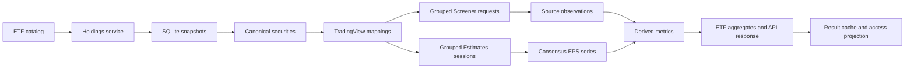

# Architecture and data contracts

This document contains the durable technical decisions behind Weightings
Analytics. It describes current behaviour, not implementation history or a
work plan.

## Layers and Metrics Overview flow



API handlers validate HTTP input and delegate to services. Services coordinate
providers and repositories. Domain processors contain calculations that are
independent of persistence and the interface.

The Metrics Overview pipeline is split by responsibility:

- `metrics-overview-service.ts` validates, orchestrates, and assembles results.
- `metrics-overview-screener.ts` resolves symbols and refreshes fundamentals.
- `metrics-overview-estimates.ts` refreshes and persists consensus series.
- `metrics-overview-model.ts` builds ETF aggregates, chart points, and the DTO.

## Holdings and security identity

For supported iShares product URLs, BlackRock product data is preferred because
it includes ISIN, SEDOL, and CUSIP; regional CSV downloads are fallbacks. A
successful HTTP response is still rejected when its holdings payload is
implausibly short. ACWI requires at least
2,000 rows, CSEMAS requires 500, BGSIX requires 50, and other source funds use a
five-row minimum (`MINIMUM_EXPECTED_HOLDINGS` in `ishares-source.ts`).
Each rejected candidate advances to the next official source.

CSEMAS (`csemas-ucits`) is a native MSCI Emerging Markets Asia universe with
its own SIX/USD source and snapshot. It does not alias another ETF's holdings.

Canonical identity uses ISIN, then SEDOL, CUSIP, and finally a conservative
name-and-ticker fallback. Legacy identities are reconciled transactionally
during ingestion only when the target is unambiguous. Related holdings,
provider mappings, metrics, prices, and portfolio positions move together.

Only positive-weight equity holdings participate in constituent metrics.
For official source funds, SQLite snapshots are the sole holdings TTL cache. A
cache hit must be fresh, plausible, and use the current normalization version.
After expiry, providers are requested with `no-store`. If refresh fails, the
latest snapshot is used as stale fallback only if its row count is plausible;
an absent or implausible snapshot can therefore lead to `503`.
Only the latest successful composition is retained for each ETF; replacing it
removes the previous snapshot and its holdings in the same transaction. Invalid
downloads and failed writes leave the previous composition available. This cache
does not supply the portfolio value history. Custom ETF selections are retained
in their definitions rather than inferred from superseded source snapshots.

## Portfolios, local ETFs, and display identity

Portfolio inputs use share quantities or USD values and may be negative for
short positions. Valuation uses Yahoo prices and FX, preserves share quantities,
and recalculates allocation as position value divided by NAV. NAV includes
converted cash and must remain positive. Cash additions in the same currency
accumulate; an exact zero balance removes the existing cash entry.

Saved portfolio ETFs are rebuilt from quantities, current valuation, and their
component holdings. Their snapshots use `analyzePortfolio` with canonical security
IDs. The portfolio interface uses `analyzePortfolioForDisplay` to group economic
exposures. Display IDs such as `economic:*` must never replace canonical IDs in
provider mappings, prices, persisted holdings, or constituent metrics. Grouped
rows retain a canonical quote candidate and its listing ticker.

Classic Holdings analysis includes a read-only portfolio valuation: total NAV
in USD, actual instruments with amounts and share quantities, and explicit cash
balances. Underlying dollar exposures use the original signed NAV weights,
even when the display normalizes securities without cash. Portfolio snapshots
already use NAV weights and must not be normalized as physical fund snapshots.
Portfolio holdings and analysis responses use `private, no-store`.

Custom ETFs retain selected security identities and a source universe. Their
weights are recalculated from the latest source composition; they are not frozen
copies of creation-day weights. Missing selected constituents are reported in
coverage. Selection criteria are stored for editing; refreshed holdings follow
the saved selection rather than rerunning the original screening rules.

Positive explicit cash balances appear as currency-specific cash holdings in
portfolio ETF snapshots; negative cash contributes to financing/NAV rather than
a negative cash holding row. Comparison removes cash before normalization by
default. `includeCash=true` changes the inputs to overlap and active-sleeve
calculations, not just the visible rows. Economic grouping in comparison is a
calculation view and does not rewrite stored identities.

The Holdings geography card groups existing analysis positions by country by
default, with a continent toggle. It does not fetch a separate geography dataset.
Creating a new portfolio clears the interface draft immediately; loading a saved
ETF is a separate action.
Portfolio previews (`POST /api/v1/portfolio`) do not persist a draft. Creation
posts positions and cash directly to `POST /api/v1/portfolio/save-as-etf`, which
stores only the named portfolio. Legacy `PUT /api/v1/portfolio` remains available
for existing clients; publishing that draft consumes it in the same transaction.
Reading an absent legacy draft does not create an empty portfolio in SQLite.

## Direct-stock dividends and settings

The owner-only Settings tab persists dividend withholding overrides in SQLite.
Stock overrides take precedence over country overrides, then documented country
defaults for ordinary dividends paid to non-resident individuals before treaty
relief. US defaults to 30%, Taiwan to 21%. Conditional rules (Australia, Brazil,
China, India) and unverified countries require configuration before net estimates are
shown. Source links and exceptions are embedded in `dividend-withholding.ts`.
The mapped issuer country is used, never the ADR ISIN prefix or listing venue.

The Yahoo adapter requests two years of chart dividends and splits, plus
`calendarEvents`. It uses the same listing symbol as portfolio valuation. Only
currently held direct stocks trigger requests; ETFs and their constituents do
not. Observations are shared across portfolios with a 24-hour TTL, deduplicated
in-flight requests, provider concurrency of two and a 15-minute failure backoff.
The scheduler checks hourly while the server runs. Sold stocks retain cached
events; a recorded entitlement awaiting payment can still refresh until settled.
Confirmed absence differs from transport
failure; failed refreshes retain compatible observations as stale.

Chart event dates use the exchange timezone. Announced calendar dates preserve
their UTC date-only representation. Payment dates and amounts are not inferred
from annual dividend rates; Yahoo does not supply record dates. Historical
amounts are restored to their pre-split share units. Payment currency is only
inferred from the listing. Known ex-date/payment-date pairs are persisted across
calendar rollovers so a new announcement cannot erase a pending payment date.

`portfolio_security_balances` records quantities and listing symbols transactionally
when compositions change, including zero after disposal. Migration establishes
today's baseline without fabricating earlier ownership. Eligible quantity comes
from the latest compatible balance before the ex-date in the exchange timezone.
Same-day acquisitions, unknown prior ownership and a changed listing cannot
establish an automatic entitlement. This is a balance history, not a historical trade ledger.
Stock splits and backdated ownership corrections are not automatically posted.

The dividend calendar appears below earnings in owner portfolio views only.
It shows the stock, amount per share, ex-date and payment date, with upcoming,
recent and received views. Payments are recorded automatically on or after the
known payment date, using observed gross amounts, recorded eligible shares and
the configured withholding rate. Unknown dates, amounts, entitlement, rates or
unsupported cash currencies remain unposted; the application does not invent
missing values or retroactively credit dividends predating ownership tracking.
Received amounts are estimates from Yahoo and configured rates, not broker
reconciliation; for example TSM's Yahoo gross can differ from Citi's final amount.
Fees default to zero. An optional Adjust action updates the received payment
and its cash delta atomically without requiring routine confirmation.
A unique portfolio/security/ex-date constraint prevents double credit,
including after a provider mapping change. Payment and cash are written in one
transaction; subsequent settings or provider changes never rewrite recorded payments.

Automatic credits enter NAV through the existing cash valuation and future
snapshots. This version does not accrue unpaid dividend receivables or rewrite
historical snapshots. The existing charts remain value evolution including
external flows, not a flow-adjusted total-return calculation. Short dividend
obligations require separate treatment and cannot be recorded as long income.

## Provider mappings

A usable TradingView mapping has provider `tradingview`, status `resolved`, a
non-empty compatible provider symbol, and auditable provenance:
`exact_exchange`, `confirmed_alias`, `country_fallback`, or `cross_exchange`.
The resolver retains exchange, provider description, candidates, name score,
and issuer checks. Numeric coverage alone does not make a mapping trustworthy.

European Euronext labels resolve to `EURONEXT:` before the generic `NYSE:`
fallback. Confirmed exchange-specific aliases and normalized HKEX numeric
tickers are accepted only after provider verification. Ambiguous country
fallbacks remain unresolved.

Current Screener and Estimates observations are usable only when their provider
symbol matches the current mapping. A mapping change invalidates incompatible
derived values until matching observations arrive.

## Fundamentals and consensus estimates

Metric observations keep one current row per security and indicator, including
source fundamentals, derived estimate ratios, EPS series, and upcoming earnings.
A successful refresh replaces that row even on a different day; older responses
cannot overwrite newer captures. The observation date is freshness metadata, not
a history key. Invalid inputs or failed refreshes preserve the previous usable
cache. A confirmed absence is still masked in results, and derived invalidation
markers prevent incompatible values from being shown.

Migration 0019 removes superseded daily observations and source compositions
while preserving the newest usable data. Portfolio value snapshots, ownership
balances needed for dividend entitlements, and recorded payments are retained.
Catalogue cleanup removes caches of removed securities while keeping securities
referenced by current holdings, portfolios, dividend records, or custom selections.

TradingView Screener fields are requested in grouped batches. A field missing
from a successful response creates a temporary, field-level negative-cache
entry, hides any older value for the current result, and lowers coverage. A
failed batch never creates a missing entry; a compatible stored value may be
used as stale fallback.

Each valid EPS consensus series contains exactly eight unique, finite points:
the four estimates associated with the latest reported quarters and the next
four quarterly estimates. It also requires a positive price, currency, and
provider symbol. Reported or reconstructed EPS values are never substituted.

The bounded in-memory negative cache has separate instances for Screener fields
and EPS series. SQLite table `provider_negative_cache` persists only confirmed
absences across restarts. Expired entries are ignored on lookup and pruned before
the first cache hydration for a database in each metrics-service process. There
is no periodic purge; expired rows may remain stored until the next hydration.
Entries are deleted when data becomes available again. Transport failures are never stored
as absences.

## Metrics Overview source status

| Status | Meaning | Displayed data |
| --- | --- | --- |
| `live` | Fresh and complete provider response | Fresh result |
| `cached` | Compatible caches are complete; no provider call is needed | Persisted result |
| `partial` | A symbol, field, or series is confirmed missing | Reduced coverage with a warning |
| `stale` | A refresh failed or holdings expired | Latest compatible fallback, if any |

Typed warnings distinguish stale holdings, unresolved mappings, incomplete
Screener data, and incomplete Estimates data. `stale` takes precedence when a
response contains both confirmed gaps and a real provider failure.

## Aggregation rules

- Consensus P/E, P/E TTM, P/B, P/S, EV/EBITDA, and P/FCF use a
  holding-weighted harmonic mean over positive covered ratios.
- Operating margin, ROIC, revenue growth, diluted EPS growth, yield, ROE,
  debt/equity, and beta use an arithmetic mean over covered holding weight.
- Market capitalisation uses a holding-weighted median.
- Estimate-driven ETF growth compares aggregate earnings yields for components
  with positive historical and forward P/E values:

```text
sum(weight / PE_forward) / sum(weight / PE_historical) - 1
```

Missing or non-positive endpoints reduce coverage; they are never treated as
zero growth. Each aggregate exposes coverage and the oldest/latest capture
window of its contributing observations.

The constituent chart uses fixed Q-3-to-next-quarter measures, independent of
the 4Q/2Q/1Q roll-down selector. Its x-axis is
`P/E Q-3 / P/E next quarter - 1`; its y-axis is next-quarter P/E. Selected ETFs
are fixed-size squares. Constituents with incomplete endpoints, non-positive
P/E, or positions beyond the top 500 are counted separately. Robust 5th–95th
percentile axes are bounded by IQR fences; excluded visual outliers remain in
the data and the full range can be displayed.

The `/api/v1` DTO retains `securityId`, `providerSymbol`, historical and forward
EPS sums, and complete `estimatePoints`. Existing fields may be nullable but
must not be silently removed or compacted without a new API version.

## Persistence and HTTP caching

Core tables include holdings snapshots, holdings, securities, provider symbols,
metric definitions, metric observations, portfolios, local ETFs, and the
provider negative cache. Writes are transactional and large metric operations
are batched.

The bounded Metrics Overview result cache holds up to eight selections. Complete
and stale results have a 60-second in-process TTL; partial results have a
five-minute TTL. These are separate from the source TTLs. The underlying response
helper computes an ETag from serialized bytes, but the website access boundary
removes conditional request headers and ETags and returns `private, no-store`.
Every website request is authorized and projected against current visibility.

Two measured hot paths—latest numeric metrics and EPS series—use parameterized
SQL followed by TypeScript reconstruction and validation. Other database access
uses Drizzle. This exception should not be expanded without profiling.

Forced refresh is passed through the main holdings, comparison, portfolio, and
Metrics Overview flows to their source services. It bypasses normal freshness
checks but does not guarantee provider success. Refresh support is route-specific:
the FX route has no refresh query option; custom local-ETF detail currently does
not forward its GET refresh option to the holdings service.

The supported runtime is one Next.js standalone process with durable SQLite
outside `.next`. A distributed cache and multi-instance write coordination are
outside the current design.

## Change requirements

Changes to provider identity, missing-versus-failed semantics, aggregation
formulas, source status, ETag construction, or the v1 DTO require focused tests.
Run the standard test, typecheck, lint, mapping audit, and production build
before release. GitHub Actions checks Windows installation, database setup,
typecheck and tests. The Linux job also runs lint and the production build.
Performance changes must be justified by an end-to-end profile;
past micro-optimisations are not active documentation and remain available in
Git history.

## Website access and publication

The canonical `main` branch has a server-side access boundary on every v1 route and the page.
Local mode gives full access on loopback without authentication or publication UI,
including compiled local runs. Web mode adds visitor and owner roles; Docker and
the web systemd service explicitly select it. Access settings are resolved at runtime.
Cloudflare Access authenticates the owner; the application validates its signed
JWT and restricts writes to the owner origin. Public requests receive a filtered
catalog and projected analysis DTOs. Canonical provider identities and database
values remain unchanged. Exact amounts use an allowlisted valuation DTO in
Holdings analysis and a separate published-portfolio read endpoint, both limited
to fully public portfolios. Weights-only analysis omits the valuation entirely;
owner analysis retains it regardless of publication mode. Private definitions
remain owner-only.

Website responses use `private, no-store`. The Metrics computation cache remains active and
its keys include a publication revision. Writes invalidate that revision, including
in-flight reuse; public responses that overlap a write are rejected. A dependency
on a private ETF makes the derived ETF unavailable publicly. See
[website deployment](site-deployment.md) for configuration and visibility rules.
